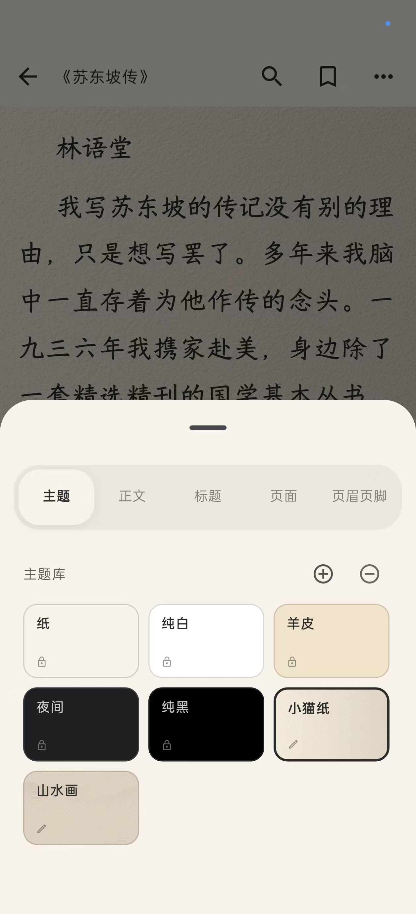
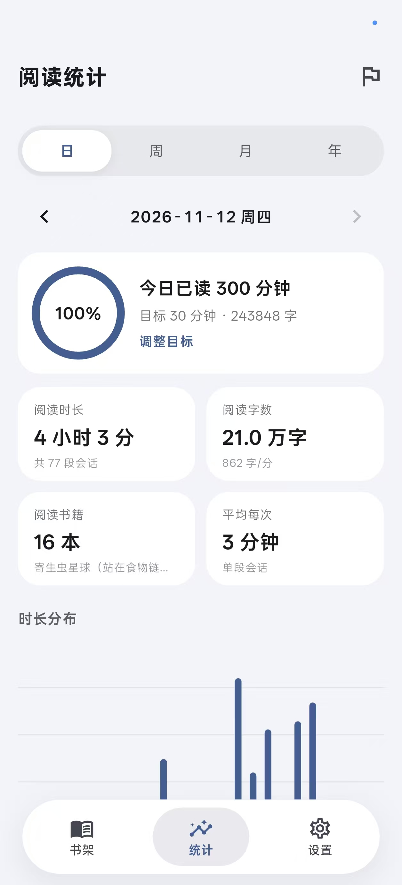
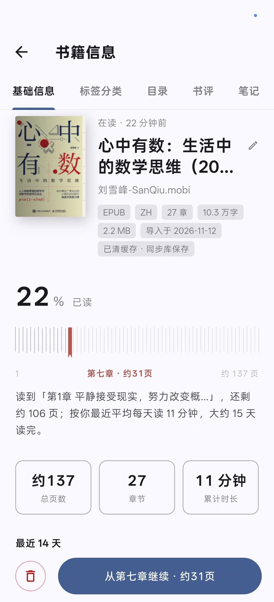
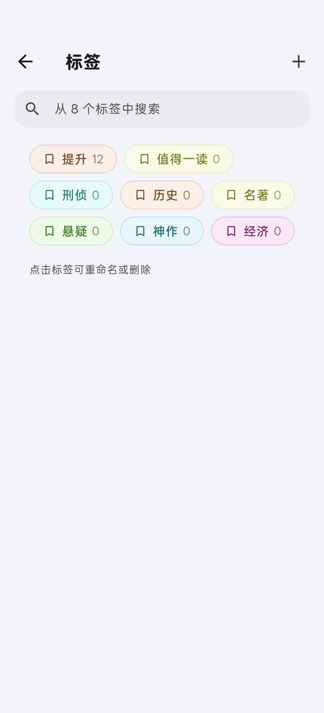

<div align="center">

# QYReader

**本地优先的跨平台阅读器 · Flutter**

书架 · 原生排版阅读 · 四色划线 · 全书检索 · TTS 朗读 · 多设备同步 · 阅读统计

<sub>数据以 SQLite 为唯一真相源，离线可用；Android 为验收平台，同时提供 Windows 桌面版。</sub>

</div>

| 版本 | 技术栈 | 数据 | 平台 |
|---|---|---|---|
| `2.40.0+130` | Flutter 3.32 · Dart 3.8 · Riverpod 2 · drift(SQLite) · go_router · freezed | SQLite schema **v5**，离线优先 | Android（minSdk 24）· Windows x64 |

---

## 截图

<table>
  <tr>
    <td align="center">
      <br>
      <sub><b>书架</b> · 分类卡、最近在读、封面网格</sub>
    </td>
    <td align="center">
      <br>
      <sub><b>阅读</b> · 原生排版、页眉页脚、自定义背景</sub>
    </td>
    <td align="center">
      <br>
      <sub><b>排版</b> · 主题库、字号行距、页眉页脚</sub>
    </td>
  </tr>
  <tr>
    <td align="center">
      <br>
      <sub><b>统计</b> · 日 / 周 / 月 / 年与时长分布</sub>
    </td>
    <td align="center">
      <br>
      <sub><b>书籍信息</b> · 进度、标签分类、继续阅读</sub>
    </td>
    <td align="center">
      <br>
      <sub><b>标签</b> · 彩色胶囊、重命名与删除</sub>
    </td>
  </tr>
</table>

## 功能

| 模块 | 能力 |
|---|---|
| **书架** | EPUB / TXT / Markdown 导入（内容寻址去重、封面压缩入库）；平铺 / 列表 / 纯封面三种展示；分类卡与未分类书同屏混排；书名搜索 + 星级 / 标签 / 阅读状态筛选；彩色胶囊标签；「最近在读」竖排架；置顶、评分、书评；多选批量删除 / 加标签 / 分组；点击右上角一键同步 |
| **阅读器** | 原生排版（不依赖 WebView），六种翻页效果：滑动 / 覆盖 / 淡入 / 仿真 / 随手仿真 / 无；翻页音效；四向边距在页面上拖动直调；单双页；页眉页脚（章节名 / 时间 / 进度 / 电量）与九宫格点击区域；章节末「下一章 / 读完」卡片 |
| **排版** | 纸 / 纯白 / 羊皮 / 夜间 / 纯黑 5 套内置主题，自定义主题保存整份排版快照；正文字号、行距、段距、字距、字重、对齐、首行缩进；标题级别样式；精排开关（保留书籍原 CSS）；自定义字体（TTF / OTF / TTC）；自定义背景图 |
| **标注** | 长按选字 → 黄 / 绿 / 蓝 / 红四色划线、写想法、复制；点击划线改色 / 编辑 / 删除；书签；目录 / 书签 / 标注三页抽屉；标注导出 Markdown |
| **检索** | 全书 FTS5 trigram（中文可用），不足 3 字自动降级 LIKE，命中片段高亮并跳回正文 |
| **朗读** | 系统 TTS（离线）、句级跟读高亮、自动翻页与续章、0.5–2.0 倍速、中文音色选择、5 / 15 / 30 / 60 分钟定时停止 |
| **同步** | 本地桶或阿里云 OSS（S3 兼容）；操作日志 + 书籍分片 + 封面 + 字体 + 背景图；HLC LWW + 最远进度合并；拉取走修改时间水位线，只下变化的对象；新设备按需下载书源 |
| **统计** | 日 / 周 / 月 / 年周期切换与前后翻期、点日期跳转；时长、字数、会话、书籍数；24 小时 / 7 天 / 当月 / 12 月分布；按书阅读明细；每日目标、累计与连续天数 |
| **外观与数据** | 亮 / 暗 / 跟随系统；6 种主题色；标签库、分类管理；缓存中心（书籍 / 字体 / 背景，只清本地，云端可再拉回） |

## 下载

| 平台 | 产物 | 说明 |
|---|---|---|
| Android | `qyreader/QYReader-v2.40.0-20261112-multiselect-delete-confirm.apk` | 31.3 MB，已用 `qyreader-release.jks` 正式签名，可直接侧载 |
| Windows x64 | `qyreader/QYReader-v2.40.0-20261112-windows-x64.zip` | 15.7 MB，解压后运行 `qy_reader.exe`，`data/` 目录必须一起保留 |

> `qyreader/` 是本地产物归档（已被 `.gitignore` 排除），只增不改；更早的版本也放在这里。

- Android：允许「安装未知来源应用」后安装；覆盖升级需使用同一签名。
- Windows：书库位于 `我的文档\QYReader`（`books/`、`covers/`、`backgrounds/`、`fonts/`），
  数据库与偏好位于 `%APPDATA%\com.qyreader\qy_reader`。

## 构建

环境：Flutter **3.32.0** / Dart **3.8.0**，Android SDK 36+，Windows 桌面版还需要 `nuget.exe` 在 `PATH` 中。

```bash
flutter pub get
dart run build_runner build --delete-conflicting-outputs   # 改了 drift / freezed 注解后必跑
flutter analyze                                            # 要求 0 issues
flutter test                                               # 全绿（当前 413 项）
flutter build apk --release                                # build/app/outputs/flutter-apk/app-release.apk
```

```powershell
# Windows 桌面版（flutter_tts 的 Windows 插件需要 nuget.exe）
$env:PATH = "$PWD\tools\nuget;" + $env:PATH
flutter build windows --release
# 整个 Release 目录一起打包，缺 data/ 会白屏
Compress-Archive -Path "build\windows\x64\runner\Release\*" `
  -DestinationPath "qyreader\QYReader-v<版本>-<yyyyMMdd>-windows-x64.zip"
```

### 签名

- 密钥：`android/qyreader-release.jks`（alias `qyreader`），密码在 `android/key.properties`；
  两者都已被 `.gitignore` 排除，**请自行备份**，丢失后无法覆盖升级。
- 缺少 `key.properties` 时自动回退 debug 签名，仍可侧载调试。
- 校验签名：`apksigner verify --print-certs build\app\outputs\flutter-apk\app-release.apk`。

## 同步

入口：**设置 → 数据 → 同步设置 → 存储**。

1. 选「本地桶」或「阿里云 OSS」。
2. OSS 填端点、桶名、对象前缀（建议 `qyreader/`）、AccessKey / SecretKey；
   区域形如 `oss-cn-hangzhou`。**OSS / R2 必须关闭路径风格**（走 `桶名.端点`），
   本项目在 OSS 配置下自动使用虚拟主机风格。
3. 密钥只存 `flutter_secure_storage`，不写库、不落偏好文件。
4. 多台设备配置**相同的桶 + 前缀 + 空间**即共享同一同步空间。

同步协议：

- 本地每次写入在同事务追加 `sync_ops`；推送未上传操作到
  `spaces/<空间>/ops/<opId>.json`。
- 书源按 SHA-256 内容寻址：`spaces/<空间>/books/<sha>.epub`；封面按书 id：
  `spaces/<空间>/covers/<bookId>.jpg`；阅读数据按书分片；字体与背景图各带 `manifest.json`。
- 拉取按 `opId` 幂等去重，对象按服务端修改时间水位线增量下载；实体按 HLC LWW 合并，
  阅读进度取最远百分比。
- 删除书籍时上传墓碑并清理云端书源 / 封面 / 分片；只清本地缓存则保留云端备份。

> 同步没有端到端加密（设计预留 AES-GCM + Argon2id，尚未实现）；凭据只保护在系统安全存储里。

## 数据与备份

| 内容 | 位置 |
|---|---|
| 数据库 | `%APPDATA%\com.qyreader\qy_reader\qy_reader.sqlite3`（Windows）／应用私有目录（Android） |
| 书源、封面、背景、字体 | `我的文档\QYReader\`（Windows）／应用支持目录（Android） |
| 排版、书架、主题等偏好 | `shared_preferences` |
| 同步凭据 | 系统安全存储（Keychain / Keystore / DPAPI） |
| 构建产物归档 | `qyreader/`（本地，不入库） |

整库备份 = 复制数据库 + `QYReader` 目录；恢复时保持两者版本一致。

## 架构

```
lib/
  app/            主题、路由、Riverpod providers、启动、页面转场
  core/           HLC 时钟、Locator、drift 数据库与 DAO、通用组件
  data/           仓储实现、EPUB/TXT 解析、封面压缩、对象存储（本地 / S3）
  domain/         实体与仓储接口（页面层不依赖 data / core-db）
  features/
    shelf/        书架、导入、搜索筛选、分类标签、同步面板、批量操作
    reader/       原生排版阅读器、划线标注、书签、TTS、全书检索、排版面板
    stats/        阅读统计（fl_chart）
    settings/     设置、阅读主题、字体 / 背景 / 缓存 / 分类管理
    tags/         标签库、标签管理、标签选择器
    home/         底部导航壳
assets/reader/    旧 WebView + epub.js 渲染链（当前已旁路，仅保留）
assets/sounds/    翻页音效
test/             单元与组件测试（413 项）
integration_test/ 翻页 / 阅读性能测试
docs/             截图与历史变更记录
qyreader/         APK / Windows 包归档（本地）
```

分层约定：`features` 只通过 Riverpod provider 拿 `domain` 接口；实现放在 `data`；
页面层不直接访问 DAO 或数据库。

## 数据库

schema **v5**，迁移只做增量 `addColumn`，不删表重建：

`books`（含 `rating` / `review` / `tags` / `pinned_at` / `category` / `read_status`）·
`chapters` · `reading_progress` · `annotations` · `bookmarks` · `reading_sessions` ·
`daily_stats` · `sync_ops` · `sync_state`，以及可重建的派生表
`book_fts`（FTS5 trigram，全书检索用）。

## 已知限制

- **PDF 暂不支持导入**：解析链覆盖 EPUB / TXT / Markdown（`BookFormat.pdf` 为预留值）。
- **iOS**：未在本机验证构建；后台朗读不支持。
- **同步冲突**：同实体并发按整行 HLC LWW，没有字段级合并；无端到端加密。
- **统计口径**：字数按翻页进度增量 × 全书字数估算，全书页数按当前章速度推算，均为约数；
  阅读会话只统计本机前台时长，不参与同步。
- **旧 WebView 链路**：`assets/reader/` 与桥接代码仍在库里，但阅读器只走原生排版。
- **依赖锁定**：`fl_chart` 锁 **0.69.2**（1.x 与 Flutter 3.32 的 `vector_math` 冲突）。

## 更新日志

- [`docs/changelog-20261111.md`](docs/changelog-20261111.md)（2.10.1 – 2.20.5）
- [`docs/changelog-20261112.md`](docs/changelog-20261112.md)（2.21.1 – 2.33.1）
- 最新版本与逐条改动见 [`AGENTS.md`](AGENTS.md) §8。

## 开发说明

面向 AI 编码代理与人类协作者的作业规范（版本递增、门禁、构建、产物命名、已知坑）
统一维护在 [`AGENTS.md`](AGENTS.md)：改代码跑 `flutter analyze` + `flutter test`，
按改动性质递增版本号，产物归档到 `qyreader/`。
